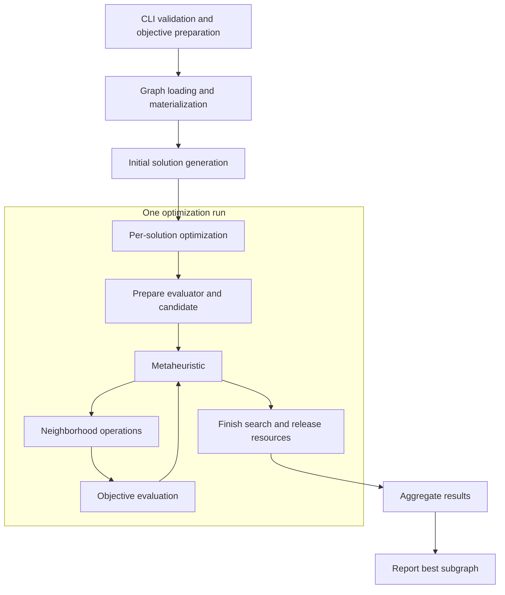

# Architecture

Fractal GM-Opt coordinates neighborhood-search metaheuristics to optimize
vertex-induced subgraphs according to a user-defined objective function.

This document describes the component responsibilities, execution flow, and
resource lifecycle. Installation and command-line instructions are provided
in the [project README](../README.md).

## 1. Architectural foundations

The system combines three layers:

| Layer | Responsibility |
|---|---|
| Fractal GM-Opt | Objective evaluation, optimization subgraphs, metaheuristics, neighborhoods, and application orchestration |
| Fractal | Input graph access, subgraph enumeration, and aggregation infrastructure |
| Apache Spark | Task scheduling and execution infrastructure |

The input graph is managed through Fractal. Optimization operates on
`VertexInducedOptimizationSubgraph` instances associated with that graph.

The [Fractal repository](https://github.com/dccspeed/fractal) provides additional
background on the underlying system. This repository includes adaptations,
so its source is the reference for the interfaces available in this version.

## 2. Optimization components

An optimization execution combines an objective function with three strategy
components.

| Component | Responsibility | Current application configuration |
|---|---|---|
| Objective function | Assign a score to a candidate subgraph | User-supplied Java implementation or JavaScript function |
| Initial solution generation | Produce starting candidates | `RandomWalkEnumerator` |
| Neighborhood structures | Define candidate transformations and search operations | Vertex addition, removal, and swapping |
| Metaheuristic | Coordinate exploration using the configured neighborhoods | VNS, ILS, or TS |

The framework maximizes objective function scores. A larger score represents
a better solution.

The strategies listed above are current implementations. Additional
metaheuristics, neighborhoods, and initial solution generation strategies
can be integrated into the framework.

The current CLI selects among the implemented metaheuristics and accepts
external objective functions. Neighborhood selection and initial solution
generation are configured in the application code.

## 3. Main implementation components

| Component | Responsibility |
|---|---|
| `SubgraphOptimizationCli` | Parse named options, normalize aliases, and validate application arguments |
| `SubgraphOptimizationConfig` | Hold the typed application settings |
| `SubgraphOptimizationApp` | Prepare the objective function, initialize Spark and Fractal, configure sampling, and collect results |
| `LocalSearchAggregation` | Optimize each sampled subgraph and combine candidate results |
| `VertexInducedOptimizationSubgraph` | Represent a mutable optimization candidate and its cached score |
| `SubgraphOptimization` | Instantiate the selected metaheuristic and supervise its execution |
| `SubgraphOptimizationMetaheuristic` | Define the metaheuristic execution interface |
| `SolutionNeighborhood` | Define local improvement, perturbation, and tabu-search operations |
| `ObjectiveFunctionLoader` | Load and validate a Java objective function implementation |
| `JavaScriptObjectiveFunction` | Adapt a JavaScript function to the scoring interface |
| `ObjectiveCopyStrategy` | Allow resource-backed objective functions to control candidate-copy behavior |

`SubgraphOptimizationConfig`, `SubgraphAndCost`, and `LocalSearchAggregation`
are currently declared in `SubgraphOptimizationApp.scala`.

## 4. Execution flow

Spark and Fractal coordinate execution across partitions. Different initial
solutions can be optimized concurrently, subject to available execution
resources.

### 4.1 Validate arguments and prepare the objective function

The application parses and validates arguments before creating its Spark
context.

Exactly one objective function input is required:

- A Java class name.
- A JavaScript source file path.

For Java, the driver loads the class, constructs an instance, and checks that
its initial state can be copied through serialization. The implementation
and its dependencies must be available through Spark's application classpath.

For JavaScript, the driver reads the file into a serializable source
definition. Script evaluation and entry-point validation occur when a
worker opens a runtime for an initial solution.

Reading a script successfully does not establish that the script is valid.

### 4.2 Load and materialize the graph

The application creates a `SparkContext` and a `FractalContext`.

The graph-loading method is selected according to the declared labeling mode:

- Unlabeled.
- Vertex-labeled.
- Vertex-and-edge-labeled.

A preliminary aggregation materializes the graph before the optimization
elapsed-time measurement starts.

### 4.3 Generate initial solutions

The application configures the initial solution size, sampling target, seed,
and partition count.

The current generation strategy is `RandomWalkEnumerator`, selected through
Fractal's subgraph extension mechanism.

The requested number of initial solutions is a target rather than an exact
output guarantee. The initial vertex count applies to starting candidates;
subsequent neighborhood operations can change the candidate size.

The application's local variable named `numThreads` controls the configured
partition count. Partitions are units of scheduled work, not dedicated JVM
threads or physical CPU cores.

### 4.4 Optimize each initial solution

For each sampled `VertexInducedSubgraph`, `LocalSearchAggregation`:

1. Opens a run-specific JavaScript evaluator when applicable.
2. Constructs a `VertexInducedOptimizationSubgraph`.
3. Evaluates the initial candidate.
4. Creates the configured neighborhood structures.
5. Creates a single-thread executor for the metaheuristic.
6. Invokes `SubgraphOptimization.run`.
7. Releases execution resources and submits the result for aggregation.

Each initial solution defines a separate optimization run.

The executor used inside a run is distinct from the Spark task executing the
aggregation callback. Consequently, Spark task concurrency and the number of
JVM threads are not interchangeable measurements.

### 4.5 Aggregate and report results

`SubgraphAndCost` associates an optimization subgraph with its score.

The aggregation keeps the higher-scoring result. When scores are equal, it
prefers the subgraph containing more vertices.

Results use a shared aggregation key so they can be reduced to the result
reported by the application.

The driver collects the aggregated result and logs:

- The selected objective function.
- Elapsed time.
- The selected subgraph's vertices, vertex count, edge count, and score.

The application reports an error if no initial solutions produce a result.

## 5. Candidate state and search responsibilities

An optimization candidate contains:

- Its vertex membership and internal adjacency lists.
- Cached vertex and edge counts.
- A cached objective function score.
- Access to the underlying graph.
- An objective function evaluator.

Neighborhood operations modify candidate state. Depending on the operation,
they either recalculate the score or restore a previously known score.

The cached score must correspond to the candidate represented by the object.

Metaheuristics can use separate objects for a working candidate and the best
solution retained by the search. These objects have different responsibilities:
exploration may visit worse candidates while the retained best solution records
the best accepted result.

In particular, the intended Tabu Search contract permits a non-improving
admissible move when no move improves the overall best score. A method reporting
no overall improvement therefore does not necessarily indicate that the working
candidate was unchanged.

The final aggregation compares the results supplied by the optimization runs.
It does not independently reevaluate or verify their scores.

## 6. Objective function execution and copying

Both objective formats are exposed to optimization code through:

`SerializableToDoubleFunction<VertexInducedOptimizationSubgraph>`

Score evaluation invokes `applyAsDouble(subgraph)`. Optimization code does not
select an objective language on every evaluation.

### 6.1 Java objective functions

The loaded Java objective instance is transported with the aggregation through
Spark's serialization mechanisms.

When an optimization subgraph is copied, ordinary Java objective functions
are copied through serialization. Class resolution uses the implementation's
class loader to support external objective JARs.

Serializable instance state must remain valid throughout execution. Constructors
and objective instances should not be treated as unique across an application:
Spark distribution and candidate copying can create additional instances.

### 6.2 JavaScript objective functions

The distributed JavaScript definition contains source text and a source name.
It does not serialize a live JavaScript context.

Each initial solution opens its own runtime and resolves the script's
`evaluate(subgraph)` function. Candidate evaluations reuse that runtime.

Candidate copies within the same run reuse the evaluator through
`ObjectiveCopyStrategy`. They do not initialize a new runtime for every copy.

Evaluator access is synchronized to prevent concurrent use of a context.
Independent optimization runs do not share that context.

The initial evaluation occurs on the aggregation thread; subsequent search
evaluations can occur on the run's executor thread. Synchronization permits
sequential access across that handoff.

### 6.3 Ownership boundaries

| Resource | Owner or scope |
|---|---|
| Java class name or script path | Application configuration |
| Loaded Java objective or portable script definition | Distributed aggregation |
| Open JavaScript context | One initial solution's optimization run |
| Working candidates | Metaheuristic execution |
| Neighborhood instances | One initial solution's optimization run |
| Optimization executor | One initial solution's optimization run |
| Spark and Fractal contexts | Application |

These boundaries govern cleanup and sharing. In particular, copying a candidate
does not transfer ownership of its run's JavaScript context.

## 7. Timing and cancellation

The system exposes two distinct timing concepts.

| Measurement | Scope |
|---|---|
| `--time-limit-ms` | Waiting budget for one submitted metaheuristic execution |
| `ElapsedTimeMs` | Optimization pipeline after graph materialization, including sampling, evaluator preparation, search, aggregation, and collection |

Objective function preparation and initial-candidate evaluation happen before
the metaheuristic execution is submitted. They are outside its timeout.

When that timeout expires, `SubgraphOptimization` requests interruption of the
submitted task and marks the retained subgraph as finished. Candidate copying
checks the target's finished state before updating it.

Interruption is cooperative. It does not guarantee immediate termination of
arbitrary Java code or operations that do not respond to interruption.

JavaScript cleanup closes the run's context with cancellation enabled. This
does not provide a hard termination guarantee for arbitrary blocking Java
operations called from a script.

The per-run timeout is therefore not a total application deadline.

## 8. Failures and cleanup

Argument and objective-input validation failures are reported before the
application creates Spark contexts.

Failures can also occur later, including:

- Missing dependencies on workers.
- Invalid JavaScript syntax or a missing entry point.
- Exceptions from objective function evaluation.
- Invalid JavaScript return values.
- Graph-loading or optimization failures.

Objective function failures are propagated as execution failures rather than
silently converted to scores.

Run cleanup shuts down the executor and closes JavaScript resources.
Application cleanup stops the Fractal and Spark contexts through `finally`
blocks.

Cleanup requests do not by themselves establish that every user operation has
terminated.

Spark can retry failed tasks according to its configuration. An optimization
run identifier is therefore not an application-wide guarantee of exactly-once
execution, particularly across executor processes and task retries.

## 9. Extension boundaries

The architecture separates problem scoring from search coordination.

| Extension | Integration required |
|---|---|
| Objective function | Supply a compatible external Java class or JavaScript function |
| Metaheuristic | Implement the search interface and integrate algorithm selection |
| Neighborhood | Implement the neighborhood interface and configure its use in the application |
| Initial solution generation | Implement or select a Fractal enumerator and configure the extension pipeline |

Only objective functions currently have an external loading workflow in the
CLI. The other strategies require source integration and a framework rebuild.